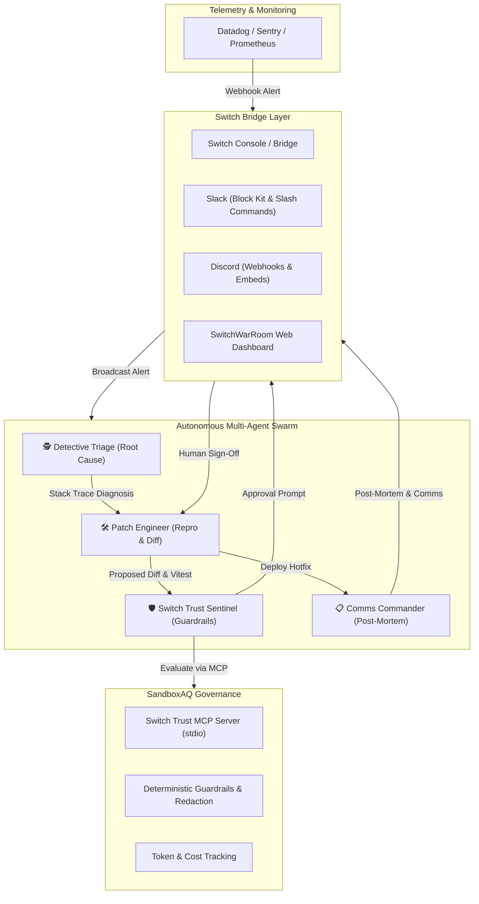

# SwitchWarRoom Architecture & Technical Design

## Overview
SwitchWarRoom bridges autonomous AI coding agents directly into shared team messaging platforms (Slack, Discord, MS Teams, Telegram, and the Switch Console) to provide collaborative, safe incident response.

---

## Component Deep Dive

### 1. Multi-Agent Orchestrator (`server/src/agents/orchestrator.ts`)
Coordinates agent turn-taking, conversation history, and incident progression:
- State Machine: `triggered` ➔ `triaging` ➔ `patching` ➔ `reviewing` ➔ `deploying` ➔ `resolved`.
- Asynchronous non-blocking event loop using Node.js event emitters.
- Emits real-time state changes to all channels simultaneously.

### 2. Switch Bridge (`server/src/switch/bridge.ts`)
Handles bidirectional integration with team messaging tools:
- **Slack Block Kit Generator:** Converts agent thoughts, code blocks, and approvals into interactive buttons.
- **Discord Rich Embeds:** Renders color-coded severity badges and code snippets.
- **WebSocket Gateway:** Feeds the interactive web war room with sub-millisecond updates.

### 3. Switch Trust Engine & MCP Server (`server/src/trust/engine.ts` & `mcp-switch-trust/`)
Enforces SandboxAQ's security and policy guardrails:
- **Static Pattern Matching:** Detects destructive shell commands (`rm -rf`, `DROP TABLE`, `mkfs`, raw credential leaks).
- **Human-In-The-Loop Approval Gates:** Halts autonomous execution on high-risk operations (e.g., prod deploys) until human sign-off is received.
- **Deterministic Secret Redaction:** Automatically masks AWS access keys, Stripe live keys, and database passwords before they reach chat or logs.
- **Model Context Protocol (MCP):** Exposes `check_command_safety`, `redact_secrets`, and `get_policy_status` over stdio JSON-RPC 2.0.

### 4. Interactive Web War Room (`client/`)
Built with React, Vite, Tailwind CSS, and Lucide Icons:
- Real-time pipeline visualizer.
- Dual-mode chat simulator & Slack Block Kit preview.
- GitHub-style before/after diff inspector.
- Real-time Switch Trust safety gauges and token spend tracker.
